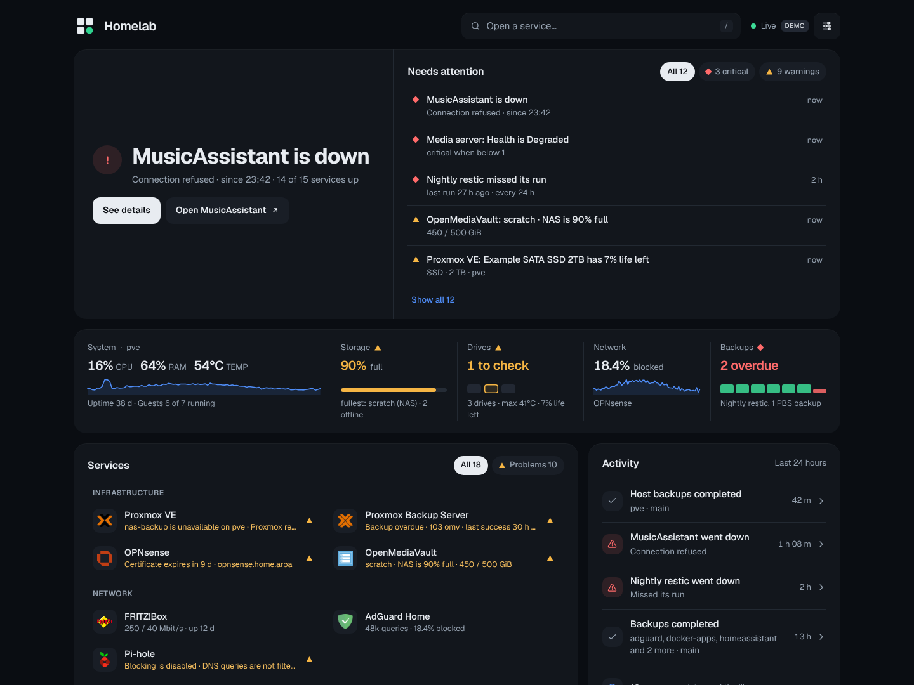
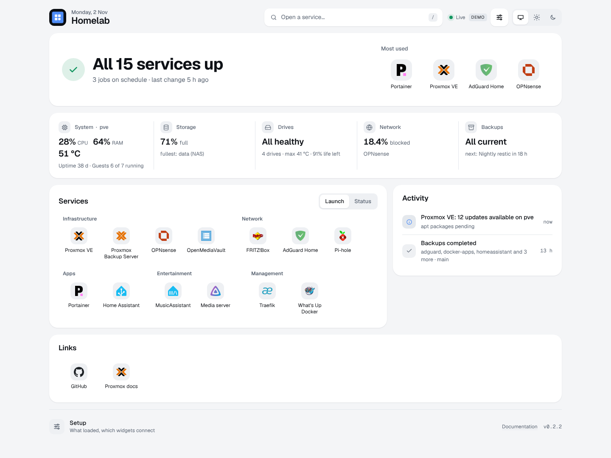
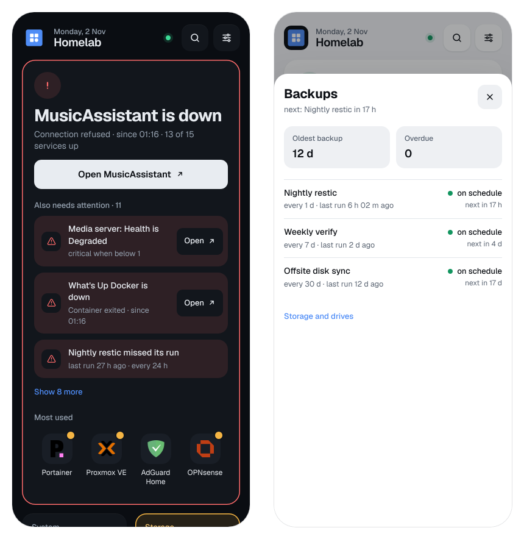

# Homelab Dashboard

[](https://github.com/matthabjan/homelab-dashboard/actions/workflows/ci.yml)
[](https://hub.docker.com/r/matthabjan/homelab-dashboard)
[](LICENSE)

A self-hosted launcher and status page for a homelab on **any Docker host**: it shows at a glance whether everything is OK and gets you to your services quickly. Proxmox VE, Proxmox Backup Server, OPNsense, OpenMediaVault, AdGuard Home or Pi-hole, Portainer or Docker, and FRITZ!Box add detail when you have them. For in-depth metrics, link out to a tool such as [Pulse](https://github.com/rcourtman/Pulse).

It is made for your **LAN or VPN** (WireGuard, Tailscale, …): it has no login of its own and must not be reachable from the internet.



- **One glance.** One sentence gives the state ("All 15 services up · 3 jobs on schedule", or the most important problem with a button to open that service), then whatever else needs attention, most severe first. When all is well, the page is short and quiet.
- **Infrastructure at a glance, details on demand.** One card with a row per area: **System** (CPU, memory, temperature of the Proxmox node or the machine the dashboard runs on), **Storage** (the fullest), **Drives** (SMART health, hottest drive, least life left), **Network** (WAN traffic, DNS block rate) and **Backups** (PBS and backup jobs, the next one due). A row opens a sheet with the full detail: 24-hour charts you can scrub through (CPU, memory, disk, temperature), every storage with its fill, grouped by the host or NAS it belongs to, every drive with SMART health, traffic charts, each job's schedule.
- **Launcher.** The services you open most, picked automatically, then every service with a link, grouped as in `services.yaml`, with nothing on an icon but a small marker when it has a problem. Press `/` or `⌘K` / `Ctrl+K` for the command palette.
- **Checks.** Services are checked every 30 s over HTTP or `tcp://`, which gives uptime (24 h and 7 d), p95 latency and a 24-hour health strip; the **Status** view of the services, and each service's sheet, show them, and the sheet lists the service's events of the last 7 days. The dashboard also tracks certificate expiry, backup age per guest, failed or unhealthy containers, SMART status and pending Proxmox updates.
- **Live and installable.** Updates are pushed to the browser as they happen, and a service whose status changes is briefly highlighted. If updates stop, the page says so and greys out instead of showing old data as current. It installs as an app (PWA) on phones and desktops, with the number of open problems on its icon, in light and dark themes.
- **Works without Proxmox.** On a plain Docker host you still get the machine's vitals, your containers (through a read-only socket proxy), values from any JSON API with alert thresholds, `tcp://` checks for services without a web page, and heartbeats: backup and cron jobs report when they ran, and a missed or failed run becomes an alert.
- **Works with gethomepage configs.** [gethomepage](https://gethomepage.dev)'s `services.yaml`, `bookmarks.yaml` and icon names work as they are; its `homepage.*` container labels work once renamed to `dashboard.*`. Services without an icon get one automatically.

**Integrations:** Proxmox VE · Proxmox Backup Server · OPNsense · OpenMediaVault · AdGuard Home · Pi-hole · Portainer · Docker · FRITZ!Box · any JSON API (`customapi`)

**Not included:** notifications (it shows problems but doesn't send them; pair it with a monitor that alerts, such as Uptime Kuma), user accounts, and editing the configuration in the browser. A read-only **Setup** page shows whether your config is right: what loaded, which widgets connect and any missing secrets, never their values.

## Screenshots





Every screenshot shows the built-in demo data (`DEMO=1`), not a real homelab.

## Quick start

To try it with built-in sample data (no homelab needed):

```bash
docker run --rm -p 3000:3000 -e DEMO=1 matthabjan/homelab-dashboard:latest
```

Open <http://localhost:3000>. Add `-e DEMO_SCENARIO=calm` to see a homelab where everything is healthy.

For your own services, copy the starter config out of the image, edit `config/services.yaml`, and start it with Docker Compose. The starter works as it is (the host's vitals, a self-check, two links) and has commented examples for Docker, Pi-hole, a JSON API, a `tcp://` check and a heartbeat. [config.example/](config.example) shows every widget.

```bash
mkdir -p config && docker run --rm --user "$(id -u):$(id -g)" -v "$PWD/config:/seed" matthabjan/homelab-dashboard:latest cp -r /config/. /seed/
```

```yaml
# compose.yaml
services:
  dashboard:
    image: matthabjan/homelab-dashboard:0.2.4 # pin a version, update deliberately
    restart: unless-stopped
    ports:
      - 127.0.0.1:3000:3000 # localhost only; reach it from the LAN or VPN through a reverse proxy
    volumes:
      - ./config:/config:ro
      - dashboard-data:/data
    environment:
      TZ: Europe/Berlin # your timezone, for times shown in the activity list
volumes:
  dashboard-data:
```

```bash
docker compose up -d
```

[Configuration](docs/configuration.md) covers settings, services, bookmarks and secrets; [Integrations](docs/integrations.md) each widget's least-privilege account. **Setup** (`/config`, the sliders button in the header) shows what loaded, which widgets connect and any problem in your files.

The app has **no login of its own**. To open it beyond localhost, put it behind a reverse proxy that handles TLS and access control, for example Traefik with an IP allowlist and basic auth; never forward a port to it from the internet. See [Deployment](docs/deployment.md).

## Documentation

| | |
|---|---|
| [Deployment](docs/deployment.md) | Production setup with Portainer and Traefik, other proxies, security, fixing failed widgets, updates, backups |
| [Configuration](docs/configuration.md) | Reference for `settings.yaml`, `services.yaml`, `bookmarks.yaml`, icons, secrets and environment variables |
| [Integrations](docs/integrations.md) | Setup, least-privilege accounts and alerts for each widget type |
| [Contributing](CONTRIBUTING.md) | Development setup, adding an integration, releases |

## Image

Multi-arch (`linux/amd64`, `linux/arm64`) images are published to Docker Hub as [`matthabjan/homelab-dashboard`](https://hub.docker.com/r/matthabjan/homelab-dashboard), with build provenance, an SBOM and a GitHub artifact attestation:

```bash
gh attestation verify oci://docker.io/matthabjan/homelab-dashboard:latest --repo matthabjan/homelab-dashboard
```

| Tag | Tracks |
|---|---|
| `X.Y.Z`, `X.Y`, `X`, `latest` | Releases |
| `edge` | `main` |
| `dev` | `development` |

Pin an exact version in production, so it only updates when you choose.

## Tech

SvelteKit 2 / Svelte 5 on Node 24 (Node adapter), history in the built-in `node:sqlite`; the only other runtime dependencies are `yaml` and `undici`. Fonts are self-hosted [Geist](https://vercel.com/font) (SIL Open Font License, see [static/fonts/OFL.txt](static/fonts/OFL.txt)). Service logos aren't bundled: they load from [selfh.st icons](https://selfh.st/icons/), [dashboard-icons](https://github.com/homarr-labs/dashboard-icons) or your own files.

## License

[MIT](LICENSE)
