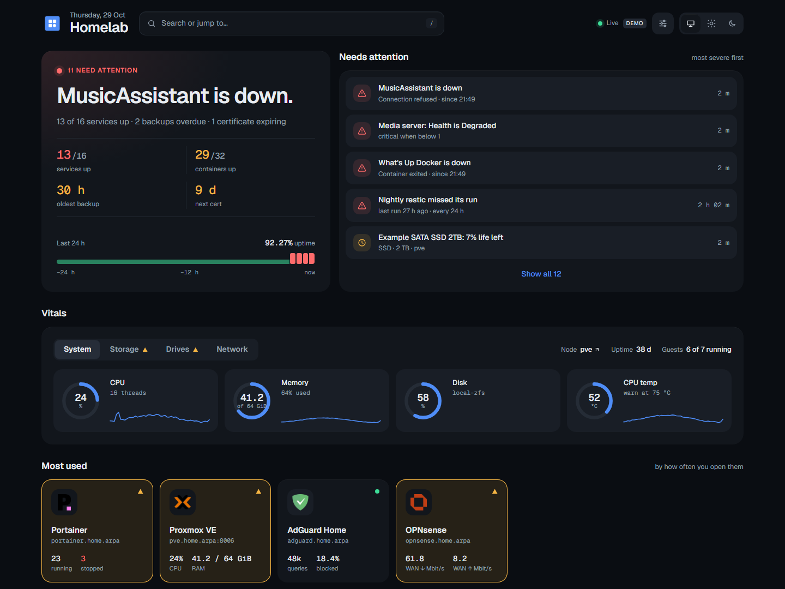
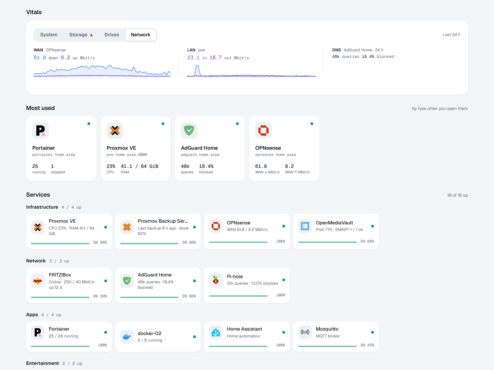
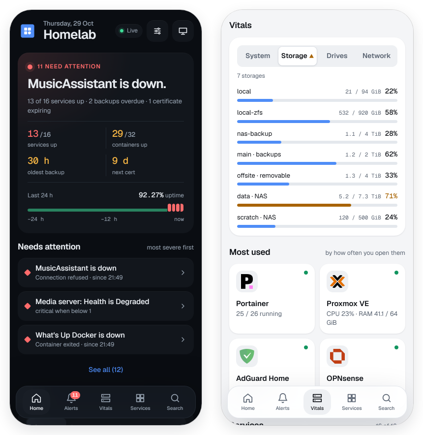

# Homelab Dashboard

[](https://github.com/matthabjan/homelab-dashboard/actions/workflows/ci.yml)
[](https://hub.docker.com/r/matthabjan/homelab-dashboard)
[](LICENSE)

A self-hosted launcher and status page for a homelab on **any Docker host**. It shows at a glance whether everything is OK and gets you to your services quickly. Proxmox VE, Proxmox Backup Server, OPNsense, OpenMediaVault, AdGuard Home or Pi-hole, Portainer or Docker, and FRITZ!Box add more detail when you have them. For detailed metrics, link out to a tool such as [Pulse](https://github.com/rcourtman/Pulse).

It is made for your **LAN or VPN** (WireGuard, Tailscale, …): it has no login of its own and is not meant to be reachable from the internet.



- **Status first.** One line at the top gives the overall state ("Everything is running." or the most important problem), followed by a list of problems ordered by severity. When nothing is wrong, that list shows recent activity instead.
- **Vitals.** One card with four tabs: **System** (CPU, RAM, main disk and temperature of the Proxmox node or the machine the dashboard runs on, each with a 24-hour trend), **Storage** (how full the storage across PVE, PBS and the NAS is), **Drives** (SMART health of the physical disks) and **Network** (WAN and LAN traffic, DNS statistics). A tab whose panel has a warning is marked, so nothing hides behind a closed tab.
- **Launcher.** The services you open most, picked automatically, then every service in its group. Press `/` or `⌘K` / `Ctrl+K` to open a command palette.
- **Checks.** Every service is checked every 30 s, which gives uptime (24 h and 7 d), p95 latency and a 24-hour health strip on each service tile. The dashboard also tracks TLS certificate expiry, backup age per guest, failed or unhealthy containers, SMART status and pending Proxmox updates.
- **Live and installable.** Updates are pushed to the browser as they happen, without reloading, and a service whose status changes is briefly highlighted. If updates stop (server unreachable, device offline), the page says so and greys out instead of showing old data as current. You can install it as an app (PWA) on phones and desktops, where the icon shows the number of open problems, and it has light and dark themes.
- **Works without Proxmox.** On a plain Docker host you still get the machine's own vitals, your containers (through a read-only socket proxy), values from any JSON API with thresholds that raise alerts, `tcp://` checks for services without a web page, and heartbeats: backup and cron jobs report when they ran, and a missed or failed run becomes an alert.
- **Works with gethomepage configs.** [gethomepage](https://gethomepage.dev)'s `services.yaml`, `bookmarks.yaml`, and icon names work as they are; its `homepage.*` container labels work once renamed to `dashboard.*`.

**Integrations:** Proxmox VE · Proxmox Backup Server · OPNsense · OpenMediaVault · AdGuard Home · Pi-hole · Portainer · Docker · FRITZ!Box · any JSON API (`customapi`)

**Not included:** notifications (it shows problems but doesn't send them; pair it with a monitor that alerts, such as Uptime Kuma, for that), user accounts, and editing the configuration in the browser. A read-only **Config & status** page shows what loaded, which widgets work and any missing secrets, without ever showing their values.

## Screenshots





Every screenshot shows the built-in demo data (`DEMO=1`), not a real homelab.

## Quick start

To try it with built-in sample data (no homelab needed):

```bash
docker run --rm -p 3000:3000 -e DEMO=1 matthabjan/homelab-dashboard:latest
```

Open <http://localhost:3000>. Add `-e DEMO_SCENARIO=calm` to see a homelab where everything is healthy.

To run it with your own services, copy the starter config out of the image, edit `config/services.yaml`, and start it with Docker Compose. The starter works as it is: the host's vitals, a self-check and two links, plus commented examples for Docker, Pi-hole, a JSON API, a `tcp://` check and a heartbeat. The full demo config is in [config.example/](config.example) if you want to see every widget.

```bash
mkdir -p config && docker run --rm --user "$(id -u):$(id -g)" -v "$PWD/config:/seed" matthabjan/homelab-dashboard:latest cp -r /config/. /seed/
```

```yaml
# compose.yaml
services:
  dashboard:
    image: matthabjan/homelab-dashboard:0.1.1 # pin a version, update deliberately
    restart: unless-stopped
    ports:
      - 127.0.0.1:3000:3000 # localhost only; reach it from the LAN or VPN through a reverse proxy
    volumes:
      - ./config:/config:ro
      - dashboard-data:/data
    environment:
      TZ: Europe/Berlin # your timezone, for times shown in the activity list
volumes:
  dashboard-data:
```

```bash
docker compose up -d
```

Settings, services, bookmarks and secrets are described in [Configuration](docs/configuration.md), and each widget's least-privilege account in [Integrations](docs/integrations.md). The page **Config & status** (`/config`, the sliders button in the header) shows what loaded, which widgets work, and any problem in your files.

The app has **no login of its own**. Keep it on your LAN or VPN and never forward a port to it from the internet. To open it beyond localhost, put it behind a reverse proxy that handles TLS and authentication, for example Traefik with an IP allowlist and basic auth. See [Deployment](docs/deployment.md).

## Documentation

| | |
|---|---|
| [Deployment](docs/deployment.md) | Production setup with Portainer and Traefik, other proxies, security, fixing failed widgets, updates, backups |
| [Configuration](docs/configuration.md) | Reference for `settings.yaml`, `services.yaml`, `bookmarks.yaml`, icons, secrets and environment variables |
| [Integrations](docs/integrations.md) | Setup, least-privilege accounts and alerts for each widget type |
| [Contributing](CONTRIBUTING.md) | Development setup, adding an integration, releases |

## Image

Multi-arch (`linux/amd64`, `linux/arm64`) images are published to Docker Hub as [`matthabjan/homelab-dashboard`](https://hub.docker.com/r/matthabjan/homelab-dashboard), with build provenance, an SBOM and a GitHub artifact attestation:

```bash
gh attestation verify oci://docker.io/matthabjan/homelab-dashboard:latest --repo matthabjan/homelab-dashboard
```

| Tag | Tracks |
|---|---|
| `X.Y.Z`, `X.Y`, `X`, `latest` | Releases |
| `edge` | `main` |
| `dev` | `development` |

Pin an exact version in production so that it only updates when you choose to.

## Tech

SvelteKit 2 / Svelte 5 on Node 24 (Node adapter). History is stored in the built-in `node:sqlite`. The only other runtime dependencies are `yaml` and `undici`. The fonts are self-hosted [Geist](https://vercel.com/font) (SIL Open Font License, see [static/fonts/OFL.txt](static/fonts/OFL.txt)). Service logos are not bundled: they load from [dashboard-icons](https://github.com/homarr-labs/dashboard-icons), [selfh.st icons](https://selfh.st/icons/) or your own files. Services without an icon get one matched by name, with a light variant for dark mode when needed.

## License

[MIT](LICENSE)
